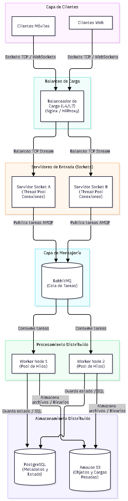

# Arquitectura de Sistema Distribuido - PFO 3

Este repositorio contiene el diseño arquitectónico y la implementación en Python de un sistema distribuido de procesamiento de tareas basado en sockets TCP, pools de hilos, colas de mensajes y almacenamiento distribuido.

- [Link a GitHub](https://github.com/andreaduran1/redes-pfo3-duran.git)
---

## 1. Diagrama de Arquitectura del Sistema



---

## 2. Descripción de Componentes y Flujo del Sistema

1. **Capa de Clientes (Móviles y Web):**
   * Establecen conexiones mediante Sockets TCP directos o WebSockets para emitir solicitudes de trabajo y recibir respuestas o notificaciones en tiempo real.
2. **Balanceo de Carga (Nginx / HAProxy - L4/L7):**
   * Opera a nivel de transporte (L4 con balanceo de streams TCP) o aplicación (L7). Distribuye las conexiones entrantes de forma equitativa entre los servidores de entrada y asegura alta disponibilidad.
3. **Servidores de Entrada (Sockets):**
   * Nodos dedicados exclusivamente a la gestión de conexiones y protocolos de red. Cuentan con un *Thread Pool* para admitir múltiples clientes simultáneamente sin bloquearse, validar las solicitudes iniciales y publicarlas como mensajes a la cola.
4. **Capa de Mensajería (RabbitMQ):**
   * Desacopla la capa de red de la capa de cómputo. Almacena las tareas pendientes en colas garantizando persistencia, reintentos y distribución equitativa (*Fair Dispatch*) hacia los nodos procesadores.
5. **Procesamiento Distribuido (Worker Nodes con Pool de Hilos):**
   * Nodos de cómputo dedicados que consumen las tareas desde RabbitMQ. Cada nodo posee su propio *Pool de Hilos* para procesar múltiples tareas concurrentemente en paralelo.
6. **Almacenamiento Distribuido:**
   * **PostgreSQL:** Persiste los estados transaccionales (`PENDIENTE`, `EN_PROCESO`, `COMPLETADA`, `ERROR`), marcas de tiempo y metadatos de las tareas.
   * **Amazon S3:** Almacena objetos grandes, binarios, archivos de entrada y resultados procesados pesados.

---

## 3. Implementación en Python

El prototipo funcional se encuentra en `src/`:

* `src/servidor.py`:
  * Implementa la recepción de sockets TCP con delimitador `\n`.
  * Maneja las conexiones mediante un pool (`listener_pool`) y distribuye el trabajo al pool de procesamiento (`worker_pool`).
  * Gestión segura del búfer de bytes y captura de excepciones para reportar estados de error estructurados sin interrumpir la conexión.
* `src/cliente.py`:
  * Cliente TCP que conecta al servidor, envía peticiones serializadas en JSON y espera las respuestas.
  * Dispone de un menú interactivo por consola para ingresar datos manualmente (suma, inversión, tareas personalizadas) y ejecutar pruebas automatizadas.
  * Configurado con timeouts y control de errores.

---

## 4. Ejecución del Prototipo

1. **Iniciar el servidor:**
   ```bash
   python src/servidor.py
   ```

2. **Ejecutar el cliente (en otra consola):**
   ```bash
   python src/cliente.py
   ```
